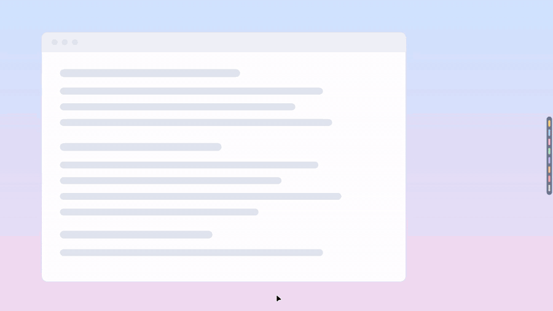
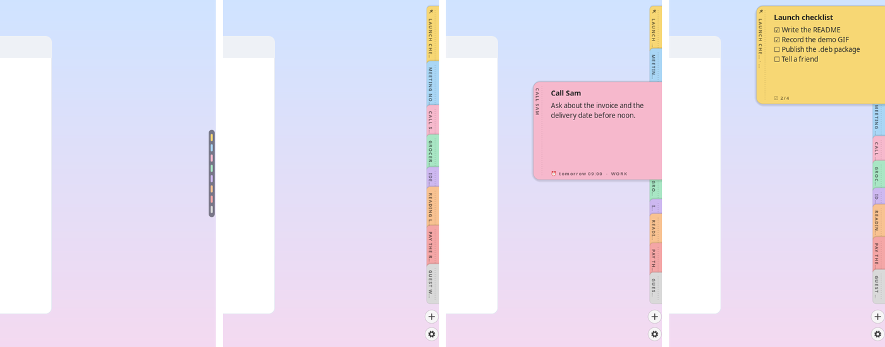
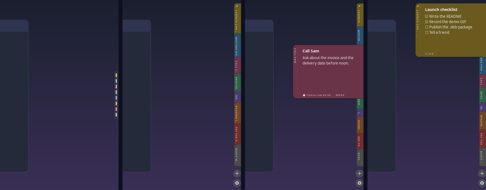
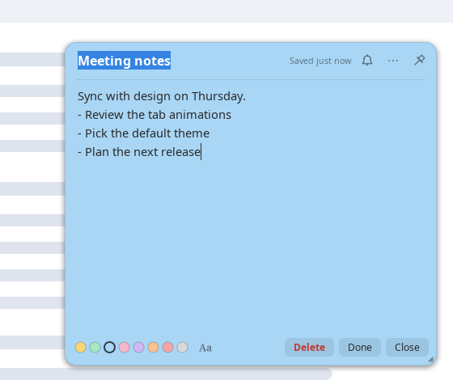
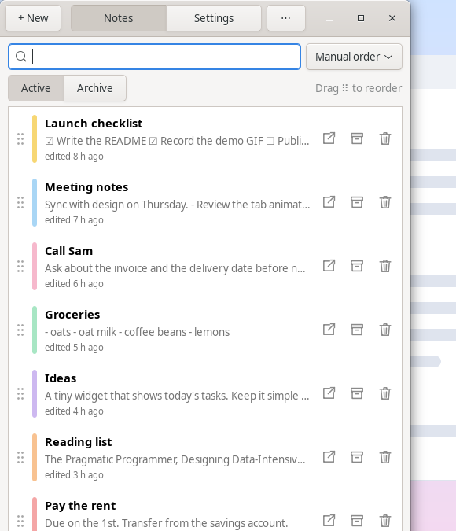
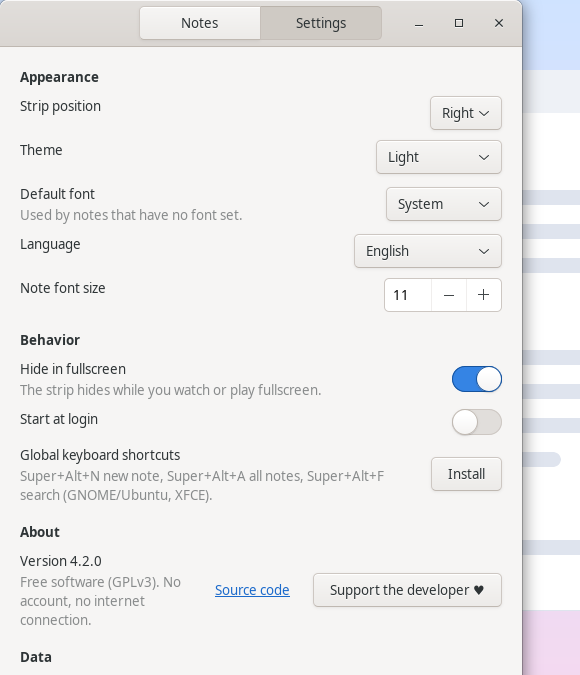
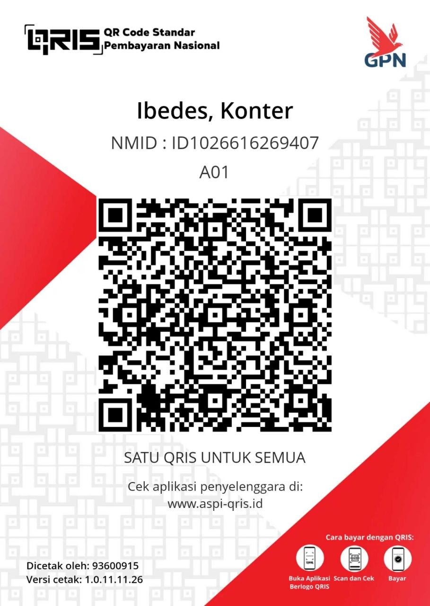

# EdgeNotes untuk Linux

[English](README.md) · **Bahasa Indonesia**

Catatan tempel yang menempel di tepi layar sebagai tab. Perangkat lunak bebas (GPLv3). Tanpa akun, tanpa cloud, tanpa koneksi internet: isi catatan tidak pernah keluar dari laptopmu.

<p align="center">
  
</p>

## Tangkapan layar

Pil tipis saat diam, tab mengembang, kartu intip dengan pengingat, dan checklist yang disematkan:



Tema terang dan gelap mengikuti sistem:



| Editor catatan | Jendela Notes | Pengaturan |
|---|---|---|
|  |  |  |

<sub>Semua tangkapan layar memakai catatan contoh di [`docs/demo/notes.json`](docs/demo/notes.json) dan direkam di
layar virtual oleh [`tools/capture-demo.sh`](tools/capture-demo.sh), jadi catatan asli tidak pernah ikut tampil.</sub>

## Pasang

**Debian / Ubuntu / Linux Mint** — unduh `edgenotes_<versi>_all.deb` dari halaman
[Releases](https://github.com/ibeeng/edgenotes/releases), lalu:

```bash
sudo apt install ./edgenotes_4.2.0_all.deb
edgenotes --install-shortcuts   # opsional: shortcut global (GNOME dan XFCE)
edgenotes &
```

**Dari sumber (semua distro)**
```bash
git clone https://github.com/ibeeng/edgenotes && cd edgenotes
sudo make install            # PREFIX=/usr/local bawaan; ubah dengan PREFIX=/usr
edgenotes --install-shortcuts   # opsional: shortcut global (GNOME dan XFCE)
edgenotes &
```

Bangun `.deb` sendiri dengan `packaging/build-deb.sh` (hasilnya di `dist/`).
Butuh: `python3`, `python3-gi`, `python3-gi-cairo`, `python3-cairo`, `gir1.2-gtk-3.0`
(Debian/Ubuntu/Mint: `sudo apt install python3-gi python3-gi-cairo python3-cairo gir1.2-gtk-3.0`).

Catatan dari versi lama terbawa otomatis. Hapus dengan `sudo make uninstall`.

## Lisensi & dukungan
EdgeNotes adalah perangkat lunak bebas di bawah **GNU GPL v3 atau lebih baru** (lihat [LICENSE](LICENSE)).
Semua fitur gratis dan tidak ada masa coba. Sejak 4.2 kode lisensi berbayar dan semua koneksi internet
(termasuk cek versi) sudah dihapus.

Kalau EdgeNotes berguna buatmu, kamu bisa mendukung pengembangannya lewat **QRIS** (semua bank dan
e-wallet: GoPay, OVO, DANA, ShopeePay, m-banking). Nominal bebas. Di aplikasi: klik kanan strip →
*Dukung pengembang ♥*, atau `edgenotes --support`.



Atau cukup **beri bintang** repositori ini dan ceritakan ke temanmu.

## Baru di 4.2
- **Open source (GPLv3).** Tanpa lisensi, tanpa masa coba, tanpa mode hanya-baca.
- **Tanpa internet sama sekali.** Cek versi otomatis dan aktivasi lisensi dihapus.
- **Shortcut global untuk XFCE** (`edgenotes --install-shortcuts`), selain GNOME. Versi sebelumnya melapor sukses di
  Linux Mint XFCE padahal menulis ke pengaturan GNOME yang tidak dipakai.
- **Terjemahan Inggris lengkap** untuk jendela Notes, Pengaturan, dan pesan.
- `edgenotes --settings` sekarang benar-benar membuka tab Pengaturan.
- Paket `.deb` (`packaging/build-deb.sh`).

## Baru di 4.1
- **Bahasa default Inggris.** Bahasa Indonesia tetap ada: Pengaturan → *Language* → *Bahasa Indonesia*, lalu klik *Restart* di notifikasi.
- **Satu jendela untuk semuanya.** Tombol ⚙ di strip (dan membuka EdgeNotes lagi dari menu aplikasi) membuka jendela EdgeNotes dengan dua tab: **Notes** (catatan aktif + arsip, cari, urutkan, impor/ekspor) dan **Settings**. Jendela ini mengingat tab terakhir yang dibuka.

## Baru di 4.0
- **Pengingat:** ikon lonceng di jendela catatan → 30 menit / 1 jam / 3 jam lagi, nanti sore, besok pagi, atau pilih tanggal & jam sendiri. Saat waktunya tiba muncul notifikasi desktop, tab catatan bergoyang dan diberi titik merah sampai dibuka.
- **Cari cepat:** `Super+Alt+F` (atau klik kanan strip → *Cari…*, `Ctrl+F` di jendela catatan). Ketik, ↑↓, Enter. Kalau tidak ketemu, Enter di baris terakhir membuat catatan baru dari teks itu.
- **Sematkan di atas strip:** menu ⋯ → *Sematkan di atas strip*. Tab yang disematkan diberi ikon pin dan selalu paling atas.
- **Gambar & link:** `Ctrl+V` gambar (screenshot, "salin gambar") langsung jadi lampiran di bawah catatan; klik untuk membuka, klik kanan untuk menyalin/menghapus. Link `http(s)://` diberi garis bawah, `Ctrl+klik` untuk membuka.
- **Grup:** menu ⋯ → *Grup*. Klik kanan strip → *Tampilkan grup* untuk menampilkan satu grup saja; nama grup muncul sebagai chip di bawah ⚙ (klik untuk ganti). Catatan baru otomatis masuk grup yang sedang ditampilkan.
- **Progres checklist:** tab menampilkan `NAMA · 2/5`, kartu intip dan jendela editor juga.
- **Mode fokus:** klik kanan strip → *Mode fokus* (30 menit / 1 jam / 2 jam), atau `edgenotes --focus 45`. Strip sembunyi lalu kembali sendiri; *Batalkan* di notifikasi untuk memunculkan lagi.
- **Riwayat versi:** menu ⋯ → *Riwayat versi…*. Versi lama disimpan otomatis (paling sering tiap 5 menit, maksimal 30 versi per catatan). Memulihkan versi lama tidak menghapus isi sekarang; isi sekarang ikut masuk riwayat.

## Fitur

### Layar & interaksi
- **Menempel di tepi layar.** Saat diam, yang terlihat hanya strip tipis berisi pil warna. Strip ini otomatis tersembunyi kalau ada aplikasi yang sedang layar penuh (butuh libwnck).
- **Hover untuk mengintip.** Saat kursor mendekat, tab-tab muncul berjajar satu per satu. Arahkan kursor ke sebuah tab, tab itu tumbuh menjadi kartu catatan di tempatnya sendiri, dan tab-tab di bawahnya terdorong turun dalam satu gerakan tanpa celah, jadi tidak ada yang tertutup. Geser kursor ke tab lain untuk mengintip catatan lain.
- **Satu jendela per catatan.** Klik tab, kartu intip, atau tombol **+** untuk membuka jendela editor. Isinya kolom judul, status *Tersimpan*, lonceng pengingat, menu ⋯ (sematkan, grup, riwayat, tempel gambar), tombol 📌 (jendela selalu di atas), isi catatan, titik warna, font **Aa**, serta tombol **Hapus**, **Selesai** (arsipkan), dan **Tutup**. Jendela bisa digeser dari judul dan diubah ukurannya dari pojok kanan bawah, dan posisinya diingat. Setelah ditutup, catatan kembali jadi tab di tepi layar.
- **Catatan baru muncul paling atas.**
- **Tombol ⚙ di bawah +** membuka Pengaturan: posisi strip, tema, font, ukuran huruf, sembunyi saat layar penuh, jalan saat login, shortcut, serta impor/ekspor.
- **Tidak menghalangi aplikasi lain.** Saat diam, jendela EdgeNotes cuma selebar strip; baru melebar ketika kursor mendekat.
- **Jendela Semua Catatan** (klik kanan strip → *Semua catatan…*, atau `Super+Alt+A`). Di sini kamu bisa mencari, mengurutkan (manual, terakhir diedit, terbaru, judul, warna), beralih tab Aktif/Arsip, menyusun ulang dengan drag ⠿, serta membuka, mengarsipkan, atau menghapus catatan.
- **Tema terang & gelap.** Otomatis mengikuti sistem (GNOME, KDE, Cinnamon, dll.), atau bisa dipaksa lewat menu *Tema*.

### Editor
- **4 font:** sistem (default), tulisan tangan, halus (serif), dan mesin ketik. Atur per catatan lewat ikon **Aa** di jendela editor; pilih *Jadikan font default* untuk catatan baru.
- **Daftar otomatis:**
  - `-` atau `*` lalu spasi → •
  - `1.` lalu spasi → daftar bernomor
  - `[ ]` lalu spasi → ☐ (klik untuk mencentang ☑)
  - Enter melanjutkan daftar; Enter di item kosong mengakhiri daftar.
- **Urutan drag-and-drop:** tahan tab (atau judul kartu intip) di pinggir layar lalu geser ke atas/bawah. Tab lain bergeser memberi tempat. Bisa juga lewat ⠿ di jendela Semua Catatan.
- **8 warna**, dipilih lewat titik warna di jendela editor.
- **Arsip:** catatan disimpan tanpa dihapus, dan bisa dikeluarkan lagi dari jendela Semua Catatan.
- **Hapus instan + Urungkan:** tidak ada pop-up konfirmasi. Muncul notifikasi "Urungkan" selama 10 detik (berlaku juga untuk arsip).

### Integrasi sistem
- **Shortcut global** (GNOME/Ubuntu dan XFCE). Pasang lewat klik kanan strip → *Pasang shortcut global*, atau `edgenotes --install-shortcuts`.

  | Shortcut | Aksi |
  |---|---|
  | `Super+Alt+N` | Catatan baru |
  | `Super+Alt+A` | Semua catatan |
  | `Super+Alt+E` | Buka/tutup catatan terakhir |
  | `Super+Alt+X` | Arsipkan catatan yang sedang dibuka |
  | `Super+Alt+F` | Cari cepat |

  Di XFCE shortcut ditambahkan ke *Pengaturan → Keyboard → Application Shortcuts* tanpa mengubah shortcut
  milikmu; `edgenotes --remove-shortcuts` menghapusnya lagi. Di KDE dan desktop lain, tambahkan shortcut secara manual ke perintah `edgenotes --new`, `--all`, `--toggle`, `--archive`, atau `--search`.
- **Jalan saat login:** menu → *Jalankan saat login*, atau `edgenotes --autostart on`.
- **Impor & ekspor:** ekspor cadangan JSON (lengkap) atau Markdown. Impor bisa dari file cadangan JSON, atau dari file `.md`/`.txt` yang masing-masing jadi satu catatan.
- **Data lokal:** catatan hanya ada di `~/.local/share/edgenotes/notes.json` (dengan cadangan otomatis `.bak`), gambar di folder `images/` di sebelahnya. Tidak ada cloud, telemetri, maupun koneksi internet.

### Performa
- **0% CPU saat diam.** Semuanya event-driven: tidak ada polling dan tidak ada timer berkala. Pengingat memakai satu timer saja yang langsung menuju pengingat terdekat. Timer hanya hidup sebentar setelah interaksi (misalnya simpan otomatis 0,5 detik setelah mengetik).
- **Jendela yang ditutup langsung dihancurkan,** bukan sekadar disembunyikan. Ini berlaku untuk jendela catatan, Semua Catatan, menu, dan notifikasi.
- **Callback animasi dilepas** begitu animasi selesai.
- **Memori sekitar 40–70 MB.** Python + GTK tidak bisa serendah 7 MB seperti aplikasi native Windows yang ditulis khusus.

## Font tulisan tangan
Supaya font tulisan tangan dan mesin ketik terlihat paling bagus, pasang **Caveat** dan **Courier Prime** dari Google Fonts:
1. Ekstrak file `.ttf`-nya ke `~/.local/share/fonts/`
2. Jalankan `fc-cache -f`
3. Restart EdgeNotes

## Wayland
EdgeNotes berjalan lewat XWayland supaya bisa menempel di tepi layar dan selalu di atas. Deteksi layar penuh hanya mengenali aplikasi X11/XWayland. Supaya latarnya transparan, desktop perlu compositor (GNOME, KDE, Cinnamon, dan XFCE dengan compositing aktif).

## Hapus
- `edgenotes --remove-shortcuts; edgenotes --autostart off`
- dari sumber: `sudo make uninstall`

Catatanmu tidak ikut terhapus.
