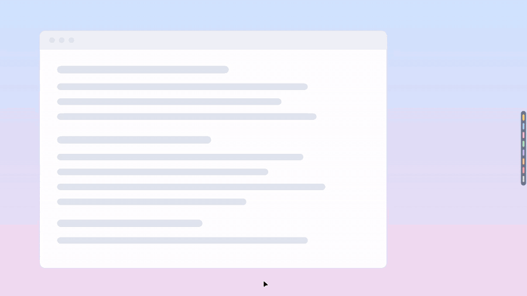
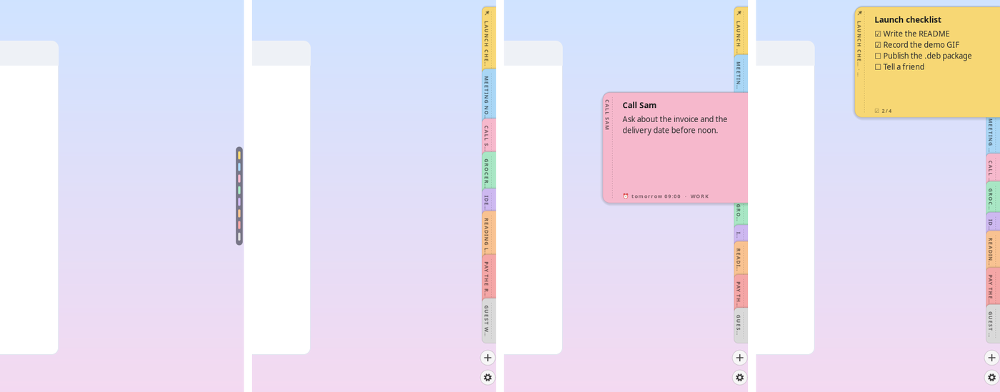
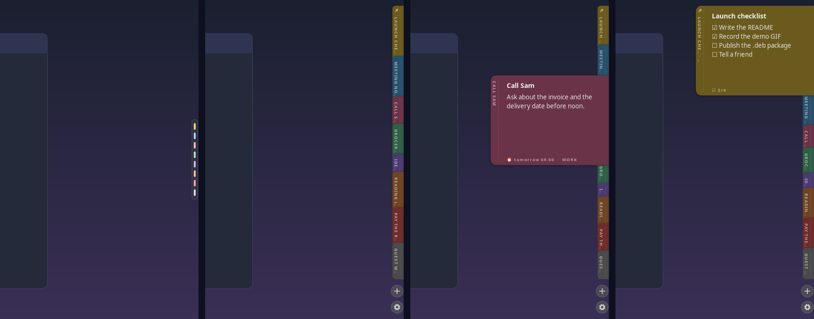
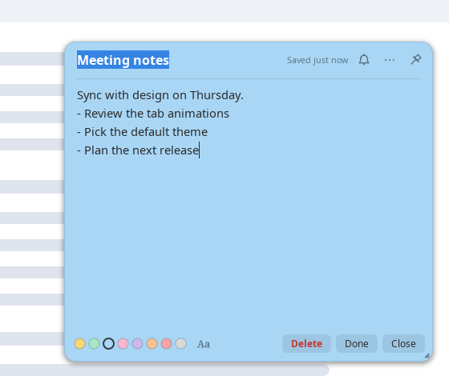
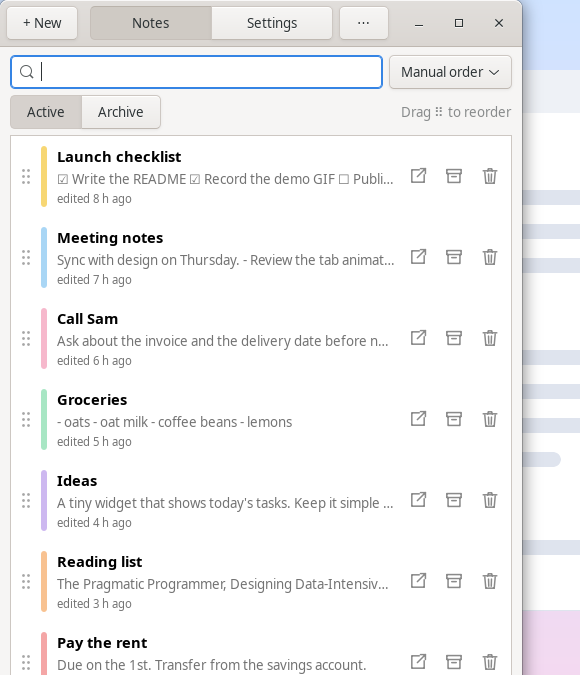
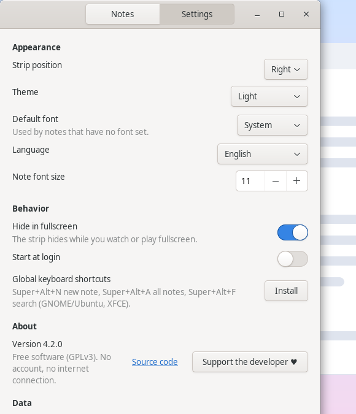

# EdgeNotes for Linux

**English** · [Bahasa Indonesia](README.id.md)

Sticky notes that live on the edge of your screen as tabs. Free software (GPLv3). No account, no cloud,
no internet connection: your notes never leave your computer.

<p align="center">
  
</p>

## Screenshots

The thin pill at rest, the tabs fanned out, a peek card with the reminder, and a pinned checklist:



Light and dark themes follow your system:



| Note editor | Notes window | Settings |
|---|---|---|
|  |  |  |

<sub>All screenshots use the sample notes in [`docs/demo/notes.json`](docs/demo/notes.json) and are recorded in a
virtual display by [`tools/capture-demo.sh`](tools/capture-demo.sh), so no real notes are ever shown.</sub>

## Install

**Debian / Ubuntu / Linux Mint** — download `edgenotes_<version>_all.deb` from the
[Releases](https://github.com/ibeeng/edgenotes/releases) page, then:

```bash
sudo apt install ./edgenotes_4.2.0_all.deb
edgenotes --install-shortcuts    # optional: global shortcuts (GNOME and XFCE)
edgenotes &
```

**From source (any distro)**

```bash
git clone https://github.com/ibeeng/edgenotes && cd edgenotes
sudo make install                # default PREFIX=/usr/local, or: make install PREFIX=/usr
edgenotes --install-shortcuts    # optional: global shortcuts (GNOME and XFCE)
edgenotes &
```

Build the `.deb` yourself with `packaging/build-deb.sh` (output in `dist/`).

Requires `python3`, `python3-gi`, `python3-gi-cairo`, `python3-cairo`, `gir1.2-gtk-3.0`
(Debian/Ubuntu/Mint: `sudo apt install python3-gi python3-gi-cairo python3-cairo gir1.2-gtk-3.0`).
Optional: `libwnck` for hiding the strip while another app is fullscreen.

Notes from older versions are picked up automatically. Remove with `sudo make uninstall`.

## Features

- **Docks to the screen edge.** A thin strip of colored pills; hover to peek, click to open a note window.
- **Reminders**, **quick search**, **pinned notes**, **groups**, **checklists with progress**, **focus mode**,
  **version history**, **images** (paste from clipboard) and **clickable links**.
- **Editor:** 4 fonts, 8 colors, auto lists (`-`, `1.`, `[ ]`), drag-and-drop ordering, archive.
- **Instant delete with Undo**, no confirmation dialogs.
- **Light and dark themes**, following your system.
- **Import / export:** full JSON backup or Markdown; import from JSON, `.md` or `.txt`.
- **Local data only:** `~/.local/share/edgenotes/notes.json` (with automatic `.bak`), images in `images/`.
  No cloud, no telemetry, no network code.
- **Idle cost:** event-driven with no polling, 0% CPU when idle. Python + GTK keeps memory around 40 MB.

## Shortcuts (GNOME and XFCE: `edgenotes --install-shortcuts`)

| Shortcut | Action |
|---|---|
| `Super+Alt+N` | New note |
| `Super+Alt+A` | All notes |
| `Super+Alt+E` | Open/close last note |
| `Super+Alt+X` | Archive the open note |
| `Super+Alt+F` | Quick search |

On XFCE the shortcuts are added to *Settings → Keyboard → Application Shortcuts* (your existing shortcuts are
left untouched); `edgenotes --remove-shortcuts` takes them out again. On KDE and other desktops, bind keys
manually to `edgenotes --new`, `--all`, `--toggle`, `--archive`, `--search`.

## Command line

```
edgenotes                     start (a thin strip docks to the screen edge)
edgenotes --new               new note
edgenotes --all               open the Notes window
edgenotes --settings          open Settings
edgenotes --support           support the developer (QRIS)
edgenotes --toggle            open/close the most recent note
edgenotes --archive           archive the note that is open
edgenotes --search            quick search
edgenotes --focus [minutes]   focus mode: hide the strip (default 60 minutes)
edgenotes --show | --hide     show / hide the peek card
edgenotes --quit              quit
edgenotes --install-shortcuts | --remove-shortcuts
edgenotes --autostart on|off  start at login
```

## Handwriting and typewriter fonts

For the best look, install **Caveat** and **Courier Prime** (Google Fonts): extract the `.ttf` files to
`~/.local/share/fonts/`, run `fc-cache -f`, and restart EdgeNotes.

## Wayland

EdgeNotes runs through XWayland so it can dock to the edge and stay on top. Fullscreen detection only sees
X11/XWayland apps. For a transparent background the desktop needs a compositor (GNOME, KDE, Cinnamon, XFCE
with compositing on).

## Support

EdgeNotes is free. If it is useful to you, you can support its development:

- **Indonesia, QRIS** (any bank or e-wallet: GoPay, OVO, DANA, ShopeePay, mobile banking). Any amount.
  Also in the app: right-click the strip → *Support the developer ♥*, or `edgenotes --support`.

  

- Or just **star the repository** and tell a friend.

## License

GPL-3.0-or-later. See [LICENSE](LICENSE).
